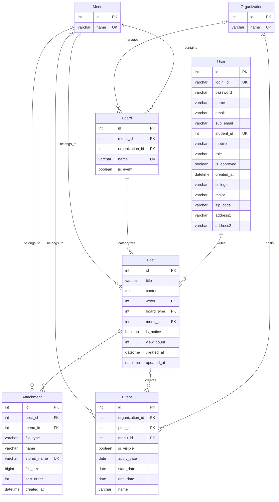
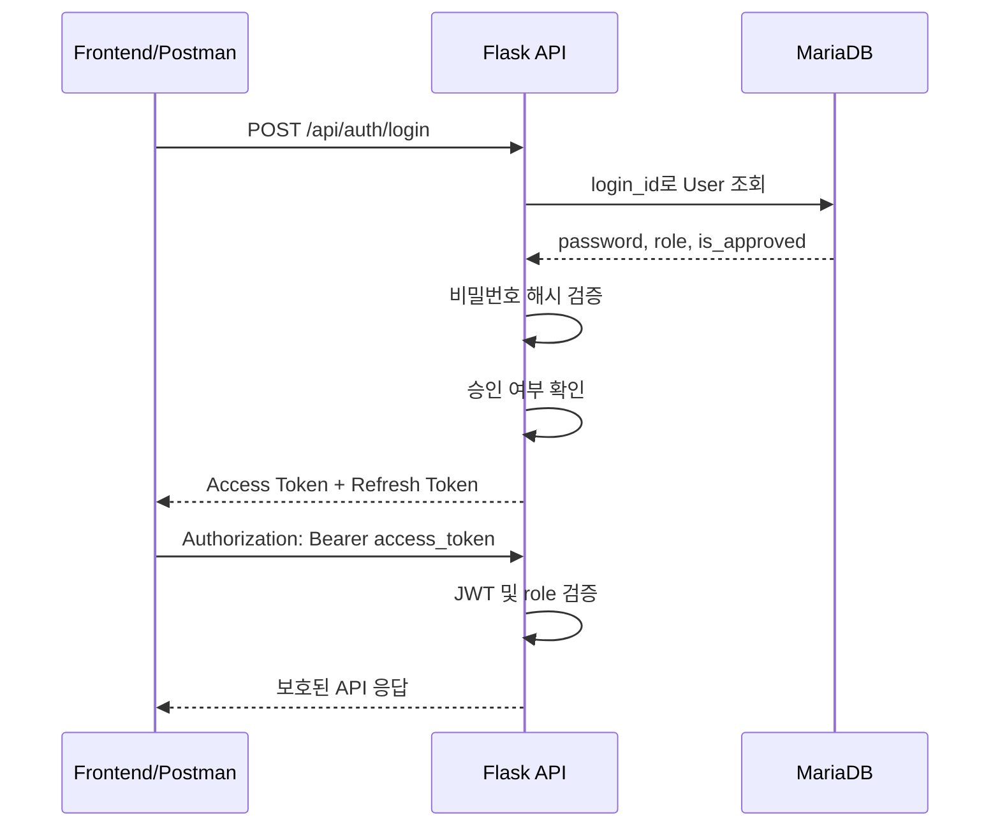

# 중대중심 백엔드 리뉴얼 변경사항

작성 기준일: 2026-08-29  
기준 자료: API 기본 명세서, 리뉴얼 ERD, `backend/app.py`

## 1. 문서 목적

이 문서는 프론트엔드 리뉴얼을 적용하기 전에 백엔드의 현재 변경 방향과
데이터 구조, API 계약, 테스트 방법, 미확정 사항을 공유하기 위한 기준
문서다.

현재 `app.py`는 기존 테이블 대신 정규화된 신규 테이블을 조회하도록
변경되어 있다. 따라서 프론트엔드 적용 전 신규 스키마가 실제 SQL 파일과
테스트 DB에 일치하게 준비되어 있어야 한다.

## 2. 현재 작업 상태

| 구분 | 상태 | 설명 |
| --- | --- | --- |
| 신규 API 로직 | 구현됨 | `User`, `Post`, `Board` 등 신규 테이블을 사용 |
| 신규 REST 경로 | 구현됨 | `/api/posts`, `/api/posts/{id}` 등 |
| 레거시 경로 호환 | 구현됨 | 기존 프론트 호출 경로를 별칭으로 유지 |
| 비밀번호 해시 | 구현됨 | Werkzeug `scrypt`/`pbkdf2` 해시 지원 |
| 첨부파일 로컬 저장 | 구현됨 | 환경변수 기반 업로드 디렉터리 사용 |
| JWT 갱신·로그아웃 | 구현됨 | Refresh Token과 메모리 기반 차단 목록 |
| 신규 스키마 파일 | 복구됨 | 신규 ERD의 7개 테이블과 기준 데이터 생성문 포함 |
| 데이터 마이그레이션 | 미구현 | 레거시 DB 데이터를 신규 테이블로 옮기는 SQL 필요 |
| 신규 더미 데이터 | 미구현 | 기존 seed 파일은 레거시 테이블 전용 |
| 프론트엔드 리뉴얼 | 미적용 | 현재까지 `frontend/` 파일 수정 없음 |

> 중요: `db/schema/schema.sql`은 대상 DB의 신규·레거시 테이블을 삭제한
> 뒤 다시 생성하는 재구축 스크립트다. 운영 또는 보존할 데이터가 있는
> DB에 직접 실행하지 말고 백업과 마이그레이션을 먼저 준비해야 한다.

## 3. 전체 구조

```text
React frontend
    │ HTTP / JSON / multipart-form-data
    ▼
Flask API (backend/app.py)
    ├── JWT 인증 및 관리자 권한 검사
    ├── 회원·게시글·일정 API
    ├── 첨부파일/섹션 이미지 저장
    └── 이메일 인증 및 임시 비밀번호 발송
            │
            ▼
MariaDB
    ├── User
    ├── Menu
    ├── Organization
    ├── Board
    ├── Post
    ├── Attachment
    └── Event
```

## 4. 신규 ERD



## 5. 테이블별 역할

### 5.1 User

회원, 관리자 권한, 승인 상태 및 프로필을 저장한다.

- `login_id`: 로그인 아이디이며 중복 불가
- `password`: 평문이 아닌 해시 저장
- `role`: `user` 또는 `admin`
- `is_approved`: 관리자 승인 완료 여부
- `student_id`: 값이 있을 경우 중복 불가
- 주소 3개 필드는 API 명세에는 있으나 원본 ERD에는 없어 추가된 필드

관리자 로그인 조건:

```text
role = admin
is_approved = true
```

### 5.2 Menu / Organization / Board

- `Menu`: 사이트의 상위 메뉴 분류
- `Organization`: 총학생회 조직·위원회
- `Board`: API에서 사용하는 게시판 slug와 메뉴·조직을 연결

예시:

```text
student-council
culture-committee
welfare-committee
human-rights-committee
graduation-committee
club-union
affiliate
activity
```

기존 `board6`, `board8` 같은 DB 내부 코드는 더 이상 API 입력값으로
사용하지 않는다.

### 5.3 Post

게시글 본문과 작성자, 게시판, 조회수, 공지 여부를 저장한다.

- `writer` → `User.id`
- `board_type` → `Board.id`
- `menu_id` → `Menu.id`
- `is_notice`는 게시글 목록 응답의 `isNotice`를 지원하기 위해 추가됨

### 5.4 Attachment

게시글 첨부파일의 메타데이터를 저장한다.

- `name`: 사용자가 올린 원본 파일명
- `stored_name`: 서버에서 생성한 충돌 없는 실제 저장 파일명
- `sort_order`: 첨부 순서
- 게시글 삭제 시 DB 첨부행과 실제 파일도 삭제
- 한 게시글당 최대 10개

### 5.5 Event

독립 일정 또는 게시글과 연결된 참여 행사를 저장한다.

API 필드와 DB 필드의 매핑:

| API 필드 | Event 필드 |
| --- | --- |
| `event_date` | `start_date` |
| `content` | `name` |
| `form_date` | `apply_date` |
| `end_date` | `end_date` |

게시글 작성 시 `isparticipate=true`이면 해당 게시글과 연결된 Event를 함께
생성한다.

## 6. 레거시 테이블 매핑

| 레거시 | 신규 구조 | 비고 |
| --- | --- | --- |
| `mTb_Member2` | `User` | 권한·승인·프로필 이름 변경 |
| `BOARD_v1` | `Post`, `Board`, `Attachment` | 게시글과 파일 정규화 |
| `calendar_events` | `Event` | 일정 필드 확장 |
| `Reply` | 없음 | ERD에 댓글 엔티티가 없어 현재 상세 응답은 `reply: []` |
| `tbl_youtube` | 없음 | 신규 명세와 ERD에 포함되지 않음 |

레거시 데이터를 유지해야 한다면 테이블별 변환 규칙을 정의한 별도
마이그레이션 SQL이 필요하다.

## 7. API 변경사항

### 7.1 인증

| Method | 정식 경로 | 인증 | 역할 |
| --- | --- | --- | --- |
| POST | `/api/auth/register` | 없음 | 회원가입 |
| POST | `/api/auth/login` | 없음 | 로그인 및 토큰 발급 |
| POST | `/api/auth/refresh` | Refresh Token | Access Token 갱신 |
| POST | `/api/auth/logout` | Access/Refresh Token | 현재 토큰 차단 |
| GET | `/api/auth/protected` | Access Token | 토큰 및 사용자 검증 |
| POST | `/api/auth/id_search` | 없음 | 아이디 찾기 |
| POST | `/api/auth/pw_search` | 없음 | 포탈 이메일로 임시 비밀번호 발급 |
| POST | `/api/auth/pw_search_by_email` | 없음 | 예비 이메일로 임시 비밀번호 발급 |
| POST | `/api/auth/email_verify` | 없음 | 인증 코드 메일 발송 |
| POST | `/api/auth/verify_code` | 없음 | 인증 코드 확인 |

회원가입의 기존 경로 `/api/user/register`도 호환 경로로 유지한다.

### 7.2 사용자

| Method | 정식 경로 | 인증 | 역할 |
| --- | --- | --- | --- |
| GET | `/api/user/profile` | Access Token | 내 정보 조회 |
| PUT | `/api/user/profile` | Access Token | 내 정보 수정 |

기존 수정 경로 `/api/user/update`도 유지한다.

### 7.3 관리자

| Method | 정식 경로 | 인증 | 역할 |
| --- | --- | --- | --- |
| GET | `/api/admin/members` | 관리자 | 승인 대기 회원 목록 |
| POST | `/api/admin/certify` | 관리자 | 회원 승인 |
| POST | `/api/admin/image` | 관리자 | 소개 섹션 이미지 교체 |

기존 `/api/admin/member`, `/api/update-section-image`도 유지한다.

### 7.4 게시글

| Method | 정식 경로 | 인증 | 역할 |
| --- | --- | --- | --- |
| GET | `/api/posts` | 없음 | 목록·검색·페이징 |
| GET | `/api/posts/{id}` | 없음 | 상세 조회 및 조회수 증가 |
| POST | `/api/posts` | 관리자 | 게시글 작성 |
| PUT | `/api/posts/{id}` | 관리자 | 게시글 수정 |
| DELETE | `/api/posts/{id}` | 관리자 | 게시글 삭제 |

목록 Query Parameter:

| 이름 | 필수 | 기본값 | 설명 |
| --- | --- | --- | --- |
| `board` | O | 없음 | 게시판 slug |
| `offset` | X | `0` | 시작 위치 |
| `limit` | X | `10` | 조회 개수, 최대 100 |
| `searchType` | X | 없음 | `title`, `content`, `author` |
| `searchTerm` | X | 없음 | 검색어 |

호환 경로:

| 레거시 경로 | 신규 경로 |
| --- | --- |
| `GET /api/dbtest` | `GET /api/posts` |
| `GET /api/detail_board?board=...&id=...` | `GET /api/posts/{id}` |
| `POST /api/create_board` | `POST /api/posts` |
| `PUT /api/update_board` | `PUT /api/posts/{id}` |
| `DELETE /api/delete_board?board=...&id=...` | `DELETE /api/posts/{id}` |

파일 없는 작성·수정은 JSON을 받을 수 있고, 첨부파일이 있으면
`multipart/form-data`를 사용한다.

### 7.5 첨부파일

| Method | 경로 | 인증 | 역할 |
| --- | --- | --- | --- |
| POST | `/api/files/download` | 없음 | DB 메타데이터 검증 후 파일 다운로드 |

다운로드 요청은 Base64 파일명 `fileName`과 선택적인 `postId`를 받는다.

### 7.6 일정

| Method | 경로 | 인증 | 역할 |
| --- | --- | --- | --- |
| GET | `/api/events` | 없음 | 공개 일정 조회 |
| POST | `/api/events` | 관리자 | 일정 추가 |
| DELETE | `/api/events` | 관리자 | ID 또는 날짜·내용으로 일정 삭제 |

### 7.7 소개 이미지와 헬스 체크

| Method | 정식 경로 | 역할 |
| --- | --- | --- |
| GET | `/api/hello` | 서버 상태 확인 |
| GET | `/api/get-section/{section}` | 섹션 이미지 조회 |

기존 `/api/get-section-image/{section}`도 유지한다.

## 8. 인증 및 권한 흐름



관리자 API는 JWT의 `role=admin`을 확인한다. 레거시 클라이언트 호환을
위해 JWT에 `user_info.intGubun`도 임시 포함한다.

## 9. 파일 저장 방식

기본 경로:

```text
backend/uploads/avanboard_v3/
```

환경변수 `UPLOAD_DIR`로 변경할 수 있다. 원본 파일명은 DB에 보관하고,
실제 파일은 UUID 기반 `stored_name`으로 저장해 파일명 충돌과 경로 이동
공격을 방지한다.

섹션 이미지는 기본적으로 다음 프론트 에셋 폴더를 사용한다.

```text
frontend/src/assets/images/02_intro_images/
```

## 10. 환경변수

| 이름 | 필수 시점 | 설명 |
| --- | --- | --- |
| `JWT_SECRET_KEY` | 운영 필수 | JWT 서명 키 |
| `PORT` | 선택 | Flask 포트, 기본 `5001` |
| `UPLOAD_DIR` | 선택 | 첨부파일 저장 경로 |
| `IMAGE_FOLDER` | 선택 | 소개 이미지 경로 |
| `MAX_UPLOAD_BYTES` | 선택 | 전체 요청 업로드 제한, 기본 50MB |
| `MAIL_SERVER` | 메일 기능 | 기본 `smtp.gmail.com` |
| `MAIL_PORT` | 메일 기능 | 기본 `465` |
| `MAIL_USERNAME` | 메일 기능 필수 | 발신 계정 |
| `MAIL_PASSWORD` | 메일 기능 필수 | 앱 비밀번호 |
| `MAIL_USE_TLS` | 선택 | 기본 `false` |
| `MAIL_USE_SSL` | 선택 | 기본 `true` |

DB 연결 정보는 아직 `backend/dbconn.py`에 직접 작성되어 있다. 운영 적용
전 `DB_HOST`, `DB_PORT`, `DB_USER`, `DB_PASSWORD`, `DB_NAME` 환경변수로
분리하는 작업이 필요하다.

## 11. 응답 및 상태 코드 정책

- 생성 성공: `201 Created`
- 일반 조회·수정·삭제 성공: `200 OK`
- 입력 오류: `400 Bad Request`
- 로그인·토큰 오류: `401 Unauthorized`
- 권한 부족: `403 Forbidden`
- 리소스 없음: `404 Not Found`
- 중복 회원: `409 Conflict`
- 메일 서버 사용 불가: `503 Service Unavailable`
- 서버 및 DB 오류: `500 Internal Server Error`

명세의 성공 키는 API별로 `status`와 `result`가 혼재한다. 현재 구현은
기존 응답 호환을 위해 이 혼용을 유지한다.

## 12. 적용 전 필수 확인사항

1. `db/schema/schema.sql` 신규 스키마 생성문 리뷰
2. 운영 또는 기존 로컬 DB 백업
3. 레거시 → 신규 테이블 데이터 마이그레이션 여부 결정
4. 신규 테스트 사용자와 더미 데이터 작성
5. `dbconn.py` 환경변수화 및 비밀값 제거
6. 메일 환경변수 설정
7. 댓글 기능 유지 또는 제거 결정
8. JWT 로그아웃 차단 목록과 이메일 인증 코드를 Redis/DB로 이전할지 결정
9. 프론트와 비밀번호 정책 통일
10. 이메일 인증 응답 키 `status`/`result` 통일

## 13. 알려진 미확정 사항

- ERD의 `id2`는 `Menu.id`를 참조하는 `menu_id`로 해석했다.
- 원본 ERD의 `Board.organization` 타입은 `VARCHAR`였으나 관계선에 맞춰
  `organization_id INT` FK로 해석했다.
- 독립 일정 생성을 지원하기 위해 Event의 조직·게시글·메뉴 FK는 nullable로
  해석했다.
- `activity` 게시판만 `is_event=true`로 보는 것이 맞는지 확인이 필요하다.
- 게시글 수정에서 새 파일을 보내면 기존 첨부파일 전체를 교체하고, 파일을
  보내지 않으면 기존 첨부파일을 유지한다.
- 회원 삭제 시 작성 게시글 삭제 여부가 정해지지 않아 User 삭제는
  `RESTRICT` 방향으로 설계했다.
- 댓글은 신규 ERD에 없어 제외했으며 상세 API는 임시로 빈 배열을 반환한다.
- Refresh Token과 Access Token의 완전한 서버 측 폐기는 현재 프로세스
  메모리에만 의존한다.

세부 판단 배경은 `backend/SPEC_ERD_DECISIONS.md`에도 기록되어 있다.

## 14. 권장 적용 순서

```text
1. schema.sql 리뷰
2. 별도 caugsa_v2_test DB에 신규 스키마 적용
3. 관리자 및 테스트 데이터 생성
4. Flask API 통합 테스트
5. 레거시 데이터 마이그레이션 작성·검증
6. 프론트엔드 API 계약 통일
7. Figma 데스크톱 화면 구현
8. 운영 DB 백업 후 마이그레이션
9. 운영 환경변수 설정 및 배포
```

현재 스키마 파일은 복구됐지만 실제 기존 DB에는 적용하지 않았다. 먼저
별도 테스트 DB에 적용해 확인한 다음 데이터 마이그레이션 여부를 결정하는
것이 안전하다.
